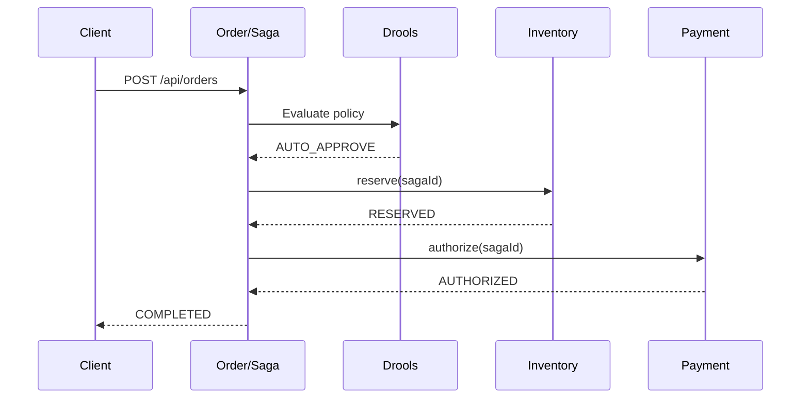
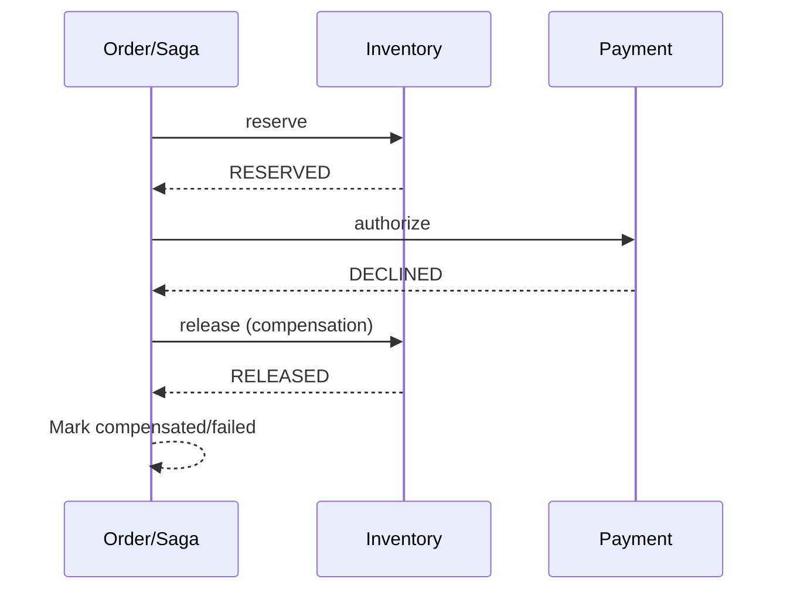

# API and Sequence Reference

## Saga happy path

## Saga compensation

## AI endpoints

| Method | Endpoint | Purpose |
|---|---|---|
| POST | `/api/knowledge/ingest` | Add a knowledge document |
| POST | `/api/knowledge/ask` | RAG question answering |
| POST | `/api/agent/run` | Goal-oriented tool-using support agent |
| POST | `/api/ml/predict-priority` | Supervised priority prediction (FastAPI) |
