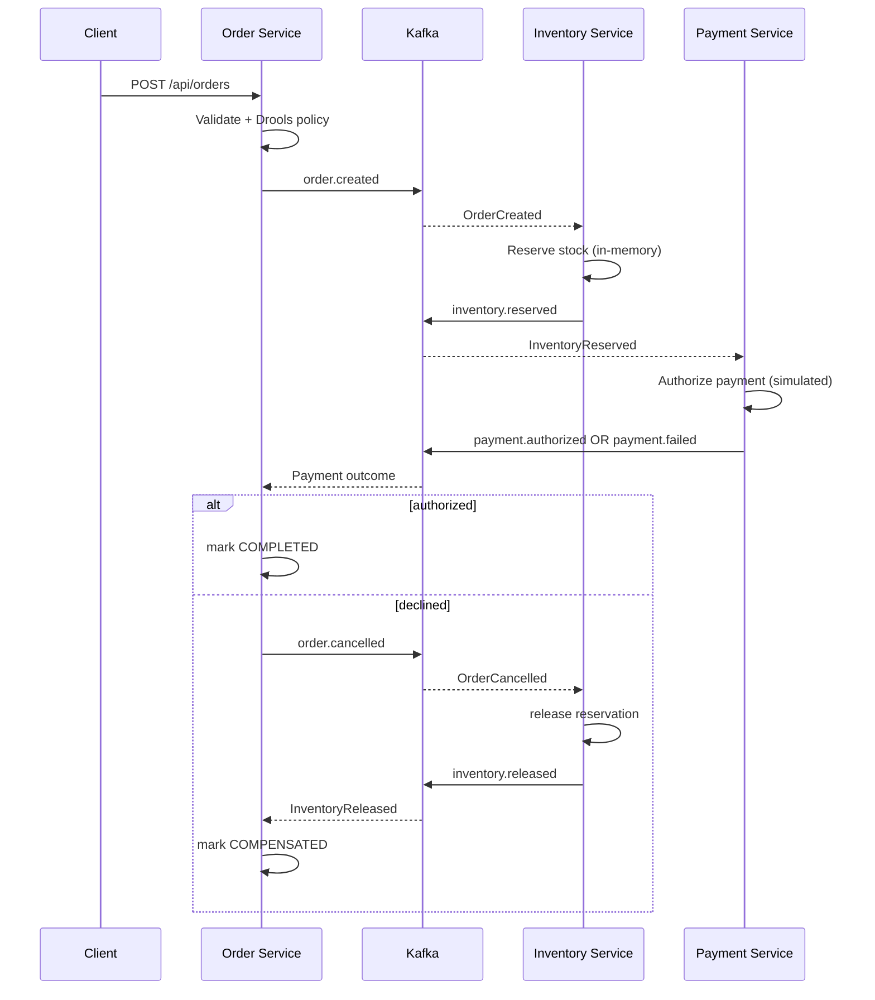

# Kafka Saga Choreography

## Event flow

## Ownership and topics

| Topic | Producer | Consumer | Meaning |
|---|---|---|---|
| `order.created` | Order | Inventory | Start workflow |
| `inventory.reserved` | Inventory | Payment | Stock reserved; payment may proceed |
| `inventory.rejected` | Inventory | Order | Stock reservation failed |
| `payment.authorized` | Payment | Order | Payment succeeded; complete order |
| `payment.failed` | Payment | Order | Payment declined; begin compensation |
| `order.cancelled` | Order | Inventory | Release previously reserved stock |
| `inventory.released` | Inventory | Order | Compensation completed |

Each service owns its own in-memory state. No service directly invokes another service's REST endpoint for Saga progression. Events are keyed by `sagaId` to preserve partition ordering for a Saga when the topic has multiple partitions.

## Failure and correctness considerations

This is a teaching implementation. Production choreography must add: idempotent consumers (deduplicate by eventId), retry/backoff and dead-letter topics, schema/version governance, transactional outbox (requires durable local persistence), event correlation, timeout handling, reconciliation, and observability. Kafka delivery is at-least-once by default; consumers must tolerate duplicate events. The sample does not provide exactly-once business effects or durable Saga state.

## In-memory requirement versus Kafka

A multi-process Kafka choreography needs a Kafka broker. The recommended no-Docker setup runs Apache Kafka locally in KRaft mode as a native Windows process. The Java service business state remains in-memory, but Kafka stores its own topic log files under its configured `log.dirs`. Point `log.dirs` at a temporary folder and delete it after stopping Kafka if you want disposable demo broker data.

`@EmbeddedKafka` from `spring-kafka-test` is suitable for integration tests, but it is not a shared broker for five separately launched application processes. To run the whole demo with no separately installed broker, the services would need to run in one JVM with an embedded broker/test harness; that is a different launch topology.
