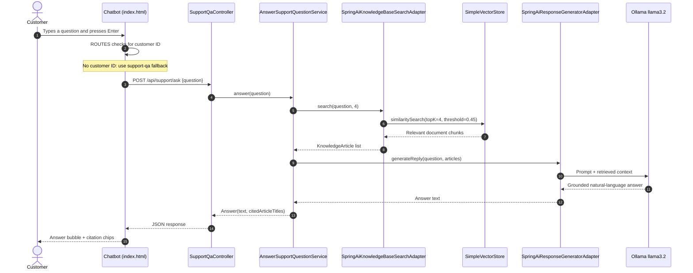
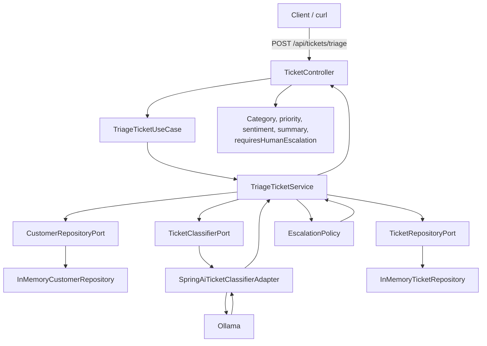
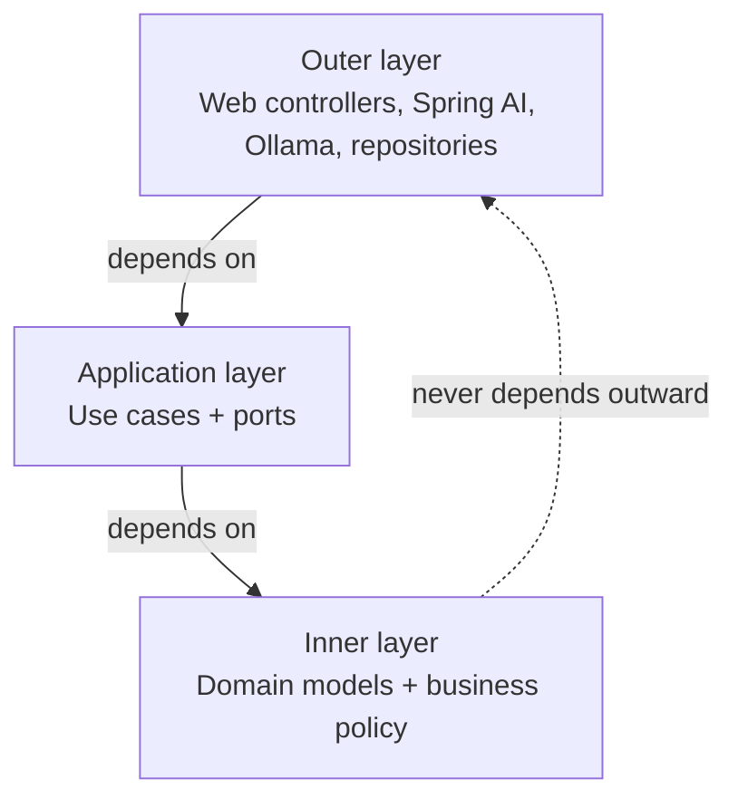

# Acme Customer Support Chatbot — Complete Architecture & Run Guide

This project is a single Spring Boot application with an embedded browser chatbot (Aria). It demonstrates **Clean Architecture / Hexagonal Architecture**, Spring AI with Ollama, retrieval-augmented generation (RAG), customer lookup, ticket triage, and human approval of AI-drafted responses.

> **Important distinction:** The browser chatbot currently routes messages only to (1) customer lookup when it detects a customer ID such as `C-1001`, or (2) knowledge-base Q&A for all other messages. Ticket triage and approval are backend REST capabilities exposed separately; they are **not automatically invoked by the current chatbot JavaScript**.

## 1. What is included

- Browser chatbot at `http://localhost:8080` (`src/main/resources/static/index.html`).
- Customer lookup: `GET /api/customers/{customerId}`.
- Knowledge-base Q&A using RAG: `POST /api/support/ask`.
- AI ticket classification and escalation decision: `POST /api/tickets/triage`.
- AI response drafting and human approval workflow:
  - `POST /api/tickets/draft`
  - `POST /api/approvals/{id}/approve`
  - `POST /api/approvals/{id}/reject`
  - `POST /api/approvals/{id}/send`
- Ollama chat model for generation/classification and embedding model for vector search.
- An alternative LangChain4j ticket-classifier adapter (not active by default).
- Unit tests for the use cases, written without starting Spring or Ollama.

## 2. Technology stack and versions

| Technology | Version / configuration |
|---|---|
| Java | 21 |
| Spring Boot | 4.1.0 |
| Spring AI | 2.0.0 |
| LangChain4j | 1.13.1 (alternative classifier demonstration) |
| Chat model | Ollama `llama3.2:latest` by default |
| Embedding model | Ollama `nomic-embed-text` by default |
| Vector store | Spring AI `SimpleVectorStore` (in-memory) |
| HTTP API | Spring MVC / REST |
| Build | Maven |

The actual versions are defined in `pom.xml`; model defaults are in `src/main/resources/application.yml`.

## 3. Architecture at a glance

The application is organised around business capabilities, not around Spring framework layers. The key rule is:

**Dependencies point inward.** The domain and application layers do not depend on web, Spring AI, Ollama, or persistence implementations. Outer adapters depend on inner contracts.

```mermaid
flowchart TB
    U["Customer"] --> UI["Browser Chatbot<br/>static/index.html"]
    UI -->|"message contains C-1001"| CC["CustomerController<br/>GET /api/customers/{id}"]
    UI -->|"all other messages"| QA["SupportQaController<br/>POST /api/support/ask"]

    CC --> G["GetCustomerDetailsUseCase"]
    QA --> A["AnswerSupportQuestionUseCase"]

    G --> GS["GetCustomerDetailsService"]
    A --> AS["AnswerSupportQuestionService"]

    GS --> CP["CustomerRepositoryPort"]
    AS --> KP["KnowledgeBaseSearchPort"]
    AS --> RP["ResponseGeneratorPort"]

    CP -. implemented by .-> CR["InMemoryCustomerRepository"]
    KP -. implemented by .-> KS["SpringAiKnowledgeBaseSearchAdapter"]
    RP -. implemented by .-> RG["SpringAiResponseGeneratorAdapter"]

    KS --> VS["SimpleVectorStore"]
    RG --> CHAT["Spring AI ChatClient"]
    CHAT --> OLL["Ollama Chat Model"]

    subgraph Other REST use cases (not currently chatbot-routed)
      TC["TicketController<br/>POST /api/tickets/triage"] --> TU["TriageTicketUseCase"]
      TU --> TS["TriageTicketService"]
      TS --> TP["TicketClassifierPort"]
      TS --> TR["TicketRepositoryPort"]
      TS --> POL["EscalationPolicy<br/>domain rule"]
      TP -. active adapter .-> CL["SpringAiTicketClassifierAdapter"]
      TR -. implemented by .-> IT["InMemoryTicketRepository"]
      AC["ApprovalController<br/>draft / approve / reject / send"] --> DS["DraftResponseService"]
      DS --> DR["DraftResponseRepositoryPort"]
    end

    CL --> OLL
```

### 3.1 The exact chatbot request path

For a normal knowledge-base question, the request travels as follows:



### 3.2 Customer ID lookup path

```mermaid
sequenceDiagram
    autonumber
    actor Customer
    participant Browser as Chatbot (index.html)
    participant Controller as CustomerController
    participant UseCase as GetCustomerDetailsService
    participant Repo as InMemoryCustomerRepository

    Customer->>Browser: "What plan is C-1001 on?"
    Browser->>Browser: Regex detects C-1001
    Note over Browser: Customer route wins; Q&A is not called
    Browser->>Controller: GET /api/customers/C-1001
    Controller->>UseCase: getCustomerDetails("C-1001")
    UseCase->>Repo: findById("C-1001")
    Repo-->>UseCase: Customer
    UseCase-->>Controller: Customer
    Controller-->>Browser: customerId, name, email, plan
    Browser-->>Customer: Structured account card
```

### 3.3 Ticket triage path (REST API, not chatbot route)



## 4. Clean Architecture explained

The source package is `com.acmesupport.cleanarch`.

### 4.1 `domain/` — enterprise business rules

Contains the business concepts that should remain stable even if the application changes frameworks:

- `model/Customer.java`, `Ticket.java`, `TicketClassification.java`, `DraftResponse.java`, `KnowledgeArticle.java`
- `policy/EscalationPolicy.java`: pure Java rule deciding whether a ticket needs human escalation.
- `exception/`: domain-level exceptions such as customer or draft not found.

The domain does not import Spring, Spring AI, LangChain4j, HTTP, or database classes.

### 4.2 `application/` — use cases and ports

This layer describes what the application can do and what it needs from outside.

**Inbound ports (`application/port/in/`)** are use-case interfaces called by controllers:

- `AnswerSupportQuestionUseCase`
- `GetCustomerDetailsUseCase`
- `TriageTicketUseCase`
- `DraftResponseUseCase`
- `ReviewDraftUseCase`

**Outbound ports (`application/port/out/`)** are interfaces the use cases need implemented:

- `KnowledgeBaseSearchPort`
- `ResponseGeneratorPort`
- `CustomerRepositoryPort`
- `TicketClassifierPort`
- `TicketRepositoryPort`
- `DraftResponseRepositoryPort`

**Use-case implementations (`application/service/`)** orchestrate the work:

- `AnswerSupportQuestionService`: retrieves up to four relevant knowledge articles, asks the response generator to answer from them, and returns the answer plus article titles.
- `GetCustomerDetailsService`: retrieves a customer or throws `CustomerNotFoundException`.
- `TriageTicketService`: loads the customer, classifies the ticket, stores it, and applies `EscalationPolicy`.
- `DraftResponseService`: creates a proposed answer and controls its review/approval/send lifecycle.

These services are plain Java classes. They do not use `@Service` or Spring imports. `UseCaseConfig` creates their beans.

### 4.3 `adapter/in/` — inbound adapters

These translate external requests into use-case calls:

- `SupportQaController`: HTTP endpoint for support Q&A.
- `CustomerController`: HTTP endpoint for customer lookup.
- `TicketController`: HTTP endpoint for ticket triage.
- `ApprovalController`: HTTP endpoints for drafting and reviewing responses.
- `ApiExceptionHandler`: maps application/domain exceptions to HTTP error responses.

Controllers depend on inbound use-case interfaces, not on concrete service classes or repositories.

### 4.4 `adapter/out/` — outbound adapters

These implement application-owned outbound ports:

- `SpringAiKnowledgeBaseSearchAdapter`: translates Spring AI vector search results into domain `KnowledgeArticle` objects.
- `SpringAiResponseGeneratorAdapter`: builds a prompt with retrieved context and calls the Spring AI `ChatClient`.
- `SpringAiTicketClassifierAdapter`: asks the model to return structured classification fields, then maps them to `TicketClassification`.
- `InMemoryCustomerRepository`, `InMemoryTicketRepository`, `InMemoryDraftResponseRepository`: in-memory repository implementations.
- `LangChain4jTicketClassifierAdapter`: alternative implementation of `TicketClassifierPort`, deliberately not enabled by default.

### 4.5 `config/` — composition and infrastructure setup

- `UseCaseConfig`: connects application use cases to their ports using Spring dependency injection.
- `VectorStoreConfig`: creates `SimpleVectorStore` and loads/splits Markdown knowledge-base files at startup.
- `WebConfig`: development CORS policy for `/api/**`. Restrict allowed origins before production.

### 4.6 The Dependency Rule in this project



For example, `TriageTicketService` depends on `TicketClassifierPort`, not `SpringAiTicketClassifierAdapter`. The adapter implements that interface. Therefore the classifier can be replaced without rewriting the use case or domain rule.

**Is this Clean Architecture?** Yes. It follows the central Clean Architecture / Ports-and-Adapters principles: inward dependencies, use-case boundaries, ports owned by the application, and infrastructure behind adapters. It is a pragmatic teaching implementation rather than a complete production platform (for example, repositories and vector store are in-memory).

## 5. How the chatbot decides where a message goes

The routing code is in `static/index.html`, in the `CONFIG`, `handleCustomerLookup`, `handleSupportQuestion`, and `ROUTES` sections.

1. The widget receives the customer's text.
2. It tests the message against `/\bC-\d{3,6}\b/i`.
3. If a customer ID is found, it calls `GET /api/customers/{customerId}` and displays a structured account card.
4. Otherwise it calls `POST /api/support/ask` with `{"question":"..."}`.
5. The support response's `text` is displayed as a chat bubble; `citedArticleTitles` are shown as citation chips.

The first matching route wins. The support Q&A route is the fallback and therefore receives every message that did not match customer lookup.

### Suggested messages to type in the chatbot

| Type this in the chatbot | Expected route | Expected result |
|---|---|---|
| `What plan is C-1001 on?` | Customer lookup | Jordan Lee account card; PRO plan |
| `Show details for C-1002` | Customer lookup | Amara Chen account card; BUSINESS plan |
| `C-9999` | Customer lookup | Friendly account-not-found message (HTTP 404) |
| `How do I reset my password?` | Support Q&A / RAG | Answer based on password and 2FA help article, with source chip |
| `How much storage does the Business plan include?` | Support Q&A / RAG | Answer grounded in storage/plan article, with source chip |
| `Can I get a refund for last month?` | Support Q&A / RAG | Answer grounded in billing/refunds article |
| `Do you accept cryptocurrency?` | Support Q&A / RAG | If the articles do not cover it, assistant should say a specialist will follow up rather than inventing policy |

**Note:** Asking `Please triage this ticket` in the current chatbot will still go to the RAG Q&A endpoint. To run ticket classification, use the triage REST endpoint shown below. The chatbot has no ticket-triage route in this version.

## 6. Prerequisites and setup

1. Install JDK 21.
2. Install Maven 3.9+ (or use the included Maven wrapper if you add one).
3. Install Ollama and ensure it is running.
4. Download the models:

```powershell
ollama pull llama3.2:latest
ollama pull nomic-embed-text
ollama list
```

Default Ollama URL is `http://localhost:11434`.

### Configuration

`src/main/resources/application.yml`:

```yaml
server:
  port: 8080

spring:
  application:
    name: clean-architecture-spring-ai
  ai:
    ollama:
      base-url: ${OLLAMA_BASE_URL:http://localhost:11434}
      chat:
        options:
          model: ${OLLAMA_CHAT_MODEL:llama3.2:latest}
          temperature: 0.2
      embedding:
        options:
          model: ${OLLAMA_EMBEDDING_MODEL:nomic-embed-text}
      init:
        pull-model-strategy: when_missing
```

Optional Windows PowerShell environment overrides:

```powershell
$env:OLLAMA_BASE_URL = "http://localhost:11434"
$env:OLLAMA_CHAT_MODEL = "llama3.2:latest"
$env:OLLAMA_EMBEDDING_MODEL = "nomic-embed-text"
```

### Start the application

Open PowerShell or Command Prompt in the project root (the directory containing `pom.xml`):

```powershell
mvn clean test
mvn spring-boot:run
```

On startup, `VectorStoreConfig` reads `classpath:knowledge-base/*.md`, splits each article into chunks, and adds them to `SimpleVectorStore`.

Open the chatbot:

- `http://localhost:8080`

The chatbot is served by the same Spring Boot application, so the default setup is same-origin and does not require a separate frontend server.

## 7. Windows curl.exe commands

Use **`curl.exe`** in Windows PowerShell to avoid PowerShell's `curl` alias. Run each command in a separate terminal after the application has started.

### 7.1 Health / reachability check

There is no dedicated Actuator health endpoint configured in this project. Use the static page as a basic reachability check:

```powershell
curl.exe -i http://localhost:8080/
```

### 7.2 RAG support Q&A

```powershell
curl.exe -X POST "http://localhost:8080/api/support/ask" -H "Content-Type: application/json" -d "{\"question\":\"How do I reset my password?\"}"
```

Another example:

```powershell
curl.exe -X POST "http://localhost:8080/api/support/ask" -H "Content-Type: application/json" -d "{\"question\":\"How much storage does the Business plan include?\"}"
```

Expected response shape (the generated wording and article titles vary):

```json
{
  "text": "Answer generated using the retrieved help articles...",
  "citedArticleTitles": [
    "storage-limits-and-upgrading-plans.md"
  ]
}
```

### 7.3 Customer lookup

```powershell
curl.exe -i "http://localhost:8080/api/customers/C-1001"
curl.exe -i "http://localhost:8080/api/customers/C-1002"
curl.exe -i "http://localhost:8080/api/customers/C-9999"
```

Expected known-customer response shape:

```json
{
  "customerId": "C-1001",
  "name": "Jordan Lee",
  "email": "jordan.lee@example.com",
  "plan": "PRO"
}
```

`C-9999` should return HTTP 404. Customer data is held in an in-memory repository; it is sample data, not a real customer database.

### 7.4 Ticket triage and AI classification

```powershell
curl.exe -X POST "http://localhost:8080/api/tickets/triage" -H "Content-Type: application/json" -d "{\"customerId\":\"C-1002\",\"ticketText\":\"I am locked out of my account again. This is unacceptable and urgent.\"}"
```

Try a calm feature request:

```powershell
curl.exe -X POST "http://localhost:8080/api/tickets/triage" -H "Content-Type: application/json" -d "{\"customerId\":\"C-1001\",\"ticketText\":\"Please consider adding a dark mode option. Thank you.\"}"
```

Response shape:

```json
{
  "category": "ACCOUNT_ACCESS",
  "priority": "URGENT",
  "sentiment": "ANGRY",
  "summary": "Customer is repeatedly locked out and is very dissatisfied.",
  "requiresHumanEscalation": true
}
```

The exact classification is model-generated and may vary. The deterministic escalation policy is: escalate only when priority is HIGH or URGENT **and** sentiment is NEGATIVE or ANGRY.

### 7.5 Draft a support response

```powershell
curl.exe -X POST "http://localhost:8080/api/tickets/draft" -H "Content-Type: application/json" -d "{\"ticketId\":\"T-1001\",\"customerId\":\"C-1001\",\"ticketText\":\"I was charged twice for my subscription. Please check and refund the duplicate charge.\"}"
```

Copy the returned draft `id` value for the next commands. The response is a draft; it is not sent automatically.

### 7.6 Approve, reject, and send a draft

Replace `DRAFT_ID_FROM_RESPONSE` with the actual `id` returned by the draft endpoint.

Approve:

```powershell
curl.exe -X POST "http://localhost:8080/api/approvals/DRAFT_ID_FROM_RESPONSE/approve" -H "Content-Type: application/json" -d "{\"reviewer\":\"supervisor1\",\"editedText\":\"We reviewed your billing concern and will investigate the duplicate charge.\"}"
```

If no edit is required, `editedText` may be an empty string:

```powershell
curl.exe -X POST "http://localhost:8080/api/approvals/DRAFT_ID_FROM_RESPONSE/approve" -H "Content-Type: application/json" -d "{\"reviewer\":\"supervisor1\",\"editedText\":\"\"}"
```

Send only after approval:

```powershell
curl.exe -X POST "http://localhost:8080/api/approvals/DRAFT_ID_FROM_RESPONSE/send"
```

Reject instead of approve (use a different draft or reject before approving):

```powershell
curl.exe -X POST "http://localhost:8080/api/approvals/DRAFT_ID_FROM_RESPONSE/reject" -H "Content-Type: application/json" -d "{\"reviewer\":\"supervisor1\",\"reason\":\"Please verify the billing transaction before responding.\"}"
```

The workflow enforces status transitions in `DraftResponseService`. A draft must be approved before it can be marked sent. This sample marks it as sent in the in-memory workflow; it does not integrate with email/SMS delivery.

## 8. RAG internals — how the answer is grounded

1. Markdown files in `src/main/resources/knowledge-base/` are read at application startup.
2. `TextReader` loads each file and records its filename as metadata (`source`).
3. `TokenTextSplitter` divides the text into smaller chunks.
4. `VectorStoreConfig` adds those chunks to `SimpleVectorStore` using the configured embedding model.
5. For a question, `AnswerSupportQuestionService` calls `KnowledgeBaseSearchPort.search(question, 4)`.
6. `SpringAiKnowledgeBaseSearchAdapter` performs similarity search with `topK=4` and similarity threshold `0.45`.
7. The retrieved chunks are converted to `KnowledgeArticle` objects.
8. `SpringAiResponseGeneratorAdapter` sends the question and retrieved context to Ollama. Its system instruction says to answer only from the context and not guess when the context is insufficient.
9. The use case returns the generated text and the source article titles; the widget displays those titles as citation chips.

This implementation uses an in-memory `SimpleVectorStore`. Its indexed data is rebuilt at startup and is not persisted across restarts. For production, consider a persistent vector store (for example PostgreSQL with pgvector), document versioning, access control, and a robust ingestion pipeline.

## 9. Ticket classification and escalation

The triage use case is deliberately independent of the AI framework:

1. `TicketController` receives customer ID and ticket text.
2. `TriageTicketService` loads the customer through `CustomerRepositoryPort`.
3. `TicketClassifierPort` is invoked.
4. The active `SpringAiTicketClassifierAdapter` calls Ollama and maps the structured result to the domain `TicketClassification`.
5. `TriageTicketService` stores a `Ticket` through `TicketRepositoryPort`.
6. `EscalationPolicy` applies the business rule.
7. The controller maps the result to an HTTP response DTO.

`LangChain4jTicketClassifierAdapter` is an alternative implementation, but it is not annotated as a Spring component and is not active by default. The current default classifier is Spring AI. Switching frameworks requires wiring the alternative adapter and providing its LangChain4j `ChatModel` bean; the use case and port remain unchanged.

## 10. Human-in-the-loop response workflow

The approval API demonstrates controlled AI assistance:

1. Draft endpoint retrieves relevant knowledge articles and generates a proposed response.
2. Draft is stored with a review status.
3. A reviewer can approve (optionally supplying edited text) or reject with a reason.
4. The send endpoint only accepts a draft whose status is `APPROVED`.
5. Sending changes the workflow status; no external communication provider is configured.

This separation is important: model-generated text is treated as a proposal, not an automatically authorised customer communication.

## 11. Important implementation notes and limitations

- **In-memory repositories:** customer, ticket, and draft records are not durable. Restarting the application resets them.
- **In-memory vector store:** knowledge-base vectors are loaded at startup and are not persisted.
- **No authentication/authorisation:** endpoints are for local demonstration. Add identity, role checks, and API security before deployment.
- **CORS:** `WebConfig` currently permits broad origins for development. Restrict it to trusted frontend origins in production.
- **No outbound delivery integration:** approval `/send` updates application state only.
- **No chatbot triage route:** current widget supports customer lookup and RAG Q&A only.
- **No conversation persistence:** chat messages remain in browser memory for the current page session; refreshing clears the visible conversation.
- **No token-usage endpoint or tracing dashboard:** this project does not currently calculate or expose prompt/completion token counts, cost, or latency metrics. Add model-call observation/metrics explicitly if those are required.
- **Sample data:** customer names and IDs are demonstration records from the in-memory repository.

## 12. Source-code map

```text
src/main/java/com/acmesupport/cleanarch/
├── SupportSystemApplication.java
├── domain/
│   ├── model/                 # Customer, Ticket, DraftResponse, classifications
│   ├── policy/                # EscalationPolicy
│   └── exception/             # Domain exceptions
├── application/
│   ├── port/in/               # Inbound use-case interfaces
│   ├── port/out/              # Outbound dependency interfaces
│   └── service/               # Plain-Java use-case implementations
├── adapter/
│   ├── in/web/                # REST controllers + HTTP exception mapping
│   └── out/
│       ├── ai/                # Spring AI / LangChain4j adapters
│       └── persistence/       # In-memory repository adapters
└── config/                    # Bean wiring, vector store, CORS

src/main/resources/
├── application.yml
├── knowledge-base/            # Markdown source documents for RAG
└── static/index.html          # Aria browser chatbot
```

## 13. Tests

Run:

```powershell
mvn test
```

The use-case unit tests instantiate services directly with simple fake ports. They do not need a running Spring context or Ollama. This demonstrates the benefit of keeping application logic independent from infrastructure.

## 14. Recommended order for a live demonstration

1. Start Ollama and confirm both models are available (`ollama list`).
2. Start the Spring Boot application.
3. Open `http://localhost:8080`.
4. Ask `How do I reset my password?` and explain the RAG sequence diagram.
5. Ask `What plan is C-1001 on?` and show that the browser routes to customer lookup rather than RAG.
6. Use the triage curl command and explain `TicketClassifierPort` → Spring AI adapter → Ollama → `EscalationPolicy`.
7. Create a draft, approve it, then send it; explain why a human approval gate is present.
8. Open the package tree and show that `domain/` and `application/` do not depend on Spring infrastructure.

---

**Main takeaway:** The chatbot is the user-facing entry point, but the application is not one large chatbot service. The browser selects a route; REST controllers enter the application through inbound ports; use cases coordinate domain rules and outbound ports; adapters connect those ports to Ollama, the vector store, and repositories. This is the core architectural idea demonstrated by the project.
